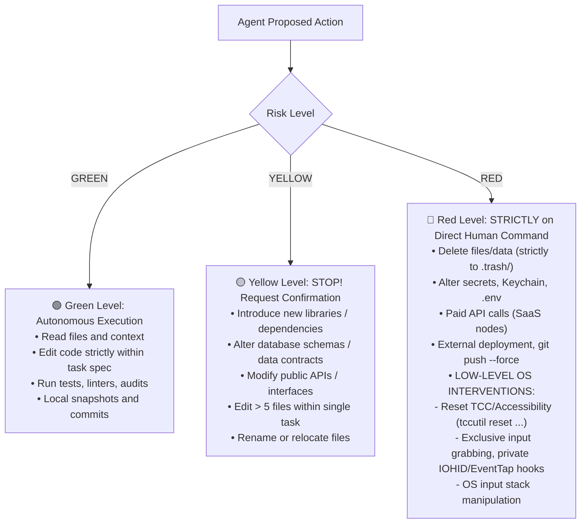

# 🛠️ DEV_PROTOCOL — Engineering Code of Conduct & Rigorous Debugging Protocol (v1.1)

> 💡 **Purpose:** Mandatory engineering protocol governing development, code modifications, and defect remediation for all AI agents (Claude, Cursor, Antigravity, OpenCode) and human contributors.  
> 🎯 **Primary Objective:** Prevent blind edits, collateral refactoring, masking bugs with dummy stubs, and codebase degradation.  
> ⚖️ **Governance:** Canonical standard across Domain III (Engineering & DAG) and Domain VI (Acceptance & Security) of AnD os.

---

## 🚦 1. Permission Matrix & Access Levels

Agents strictly adhere to the traffic-light permission protocol:



---

## 🎯 2. Fundamental Engineering Invariants

1. **Single Task — Single Goal — Single Outcome:** Any task that cannot be defined in a single phrase (verb + object) must be decomposed into subtasks within an execution DAG (Rule #20).
2. **Understand Before Modifying:** Modifying code whose existing behavior and flow have not been thoroughly analyzed is strictly forbidden.
3. **Minimal Diff & Zero Collateral Refactoring:** Modify strictly what is required for the task. Incidental renaming, "cleanups in passing", and reformatting unrelated functions are strictly forbidden (Rules #30, #35).
4. **Actionable Verifiability, Not Opinions:** Every task must have an acceptance criterion verifiable via an automated physical command (test suite, curl, script run), never by subjective impression.
5. **Reversibility (Safe Snapshot First):** Every action must be rollback-ready within seconds. No APFS CoW snapshot or commit before modification = no modification permitted (Rule #37).
6. **Empirical Facts Over Hypotheses:** The root cause of a defect is considered identified ONLY after stable reproduction and confirming experiments.
7. **Human Decides, Agent Executes:** Architectural direction, entity deletions, and financial operations require explicit human confirmation.
8. **Platform SDK & Formal Specifications First (Rule #59):** Before writing integrations or tools, inspect the official platform SDK, client libraries, and type definitions (Ftrack, ComfyUI, macOS, Obsidian API). Re-inventing custom protocols and ad-hoc structures that bypass native platform standards is strictly forbidden.
9. **System Code Integrity & Obsidian UI Guard:** With `and_os/` indexed and visible within the Obsidian UI, editing executable scripts (`.py`, `.sh`, `.json`, `.db`) as plain notes in Obsidian is strictly prohibited. Executable code modifications proceed exclusively through code editing tools and command line linters with automatic AST compilation (`py_compile`) to prevent accidental visual corruptions or unescaped character injections.

---

## 🐛 3. Rigorous 9-Step Debugging Protocol

Debugging proceeds strictly through 9 deterministic steps. Guesswork and randomized trial-and-error are prohibited:

```text
1. Capture Symptom: Exact error message, runtime environment, stack trace.
2. Reproduce: Minimal deterministic steps that reliably trigger the failure.
3. Isolate: Narrow scope to module, function, and offending input payload.
4. Formulate Hypothesis: Single concise premise: "Root cause is X because Y".
5. Test Hypothesis: Structured experiment: logging, DEBUG output, condition check (without refactoring).
6. Remediate Cause, Not Symptom: BANNED: masking stubs (bare except: pass, blind sleep, hardcoded mocks).
7. Write Regression Test: Test must fail prior to fix and pass cleanly after fix.
8. Verify Blast Radius: Ensure adjacent subsystems and features have not degraded.
9. Log Resolution: Record root cause, fix rationale, and prevention mechanism.
```

> [!CAUTION]
> ### 🛑 Hard Stop-on-3 Circuit Breaker
> 1. If **2 consecutive remediation attempts fail** for the same issue or feature, the 3rd attempt is a hard STOP line.
> 2. The agent is **CATEGORICALLY FORBIDDEN** from cycling through random tweaks, escalating privileges, accessing private APIs, or resetting system services.
> 3. Upon reaching Stop-on-3, the agent **MUST immediately halt tool execution** and present a structured stop-report:
>    - The exact hypothesis tested;
>    - The specific system barrier identified (TCC, OS permissions, architectural limit);
>    - 2–3 actionable alternative pathways for human selection.
> 4. **Anti-Beta-Tester Rule:**
>    - Clean compiler exit codes (`clang`, `gcc`, `tsc`, `python -m py_compile`) **DO NOT constitute proof of feature functionality**.
>    - If the outcome cannot be verified by an automated non-invasive script, the agent **MUST** report: `NOT VERIFIED (manual user testing required)` accompanied by 1 isolated verification action. Declaring "All done and working!" without physical proof is prohibited.

---

## 📋 4. Mandatory Report Standard (Honest Report)

Abstract claims like "everything works" are forbidden unless backed by physical verification. The `NOT VERIFIED` section is mandatory:

```text
DONE: <Specific functionality implemented>
FILES: <List of modified files with Markdown links>
VERIFIED: <Execution command, test suite, actual terminal output>
NOT VERIFIED: <What remains unverified and why>
ASSUMPTIONS: <Declared assumptions and constraints>
RISKS: <Potential blast radius and edge cases>
ROLLBACK: <Rollback command / APFS snapshot / git revert>
```

---

## 🎨 5. AI Pipelines & ComfyUI Specification (Ta-Bu & CG)

1. **Golden Set Testing:** Pipeline changes must be validated against a 5–10 test case Golden Set with before-and-after fidelity comparison.
2. **Generation Determinism:** Defect triage requires logging: base model, checkpoint hash, seed, sampler, CFG, steps, and input masks.
3. **Resource & Cost Guard:** Strictly enforce 100% free local ComfyUI nodes (Rule #45). External paid API calls require explicit owner confirmation.
