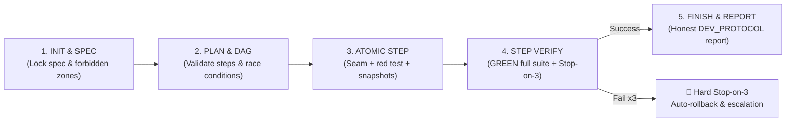

# 🚀 dev-flow — Disciplined Engineering & Development Pipeline

> **Purpose:** Canonical Primary Skill for all software development, defect remediation (bugfixing), architectural refactoring, and feature implementation across AnD os and Pulsar Space.
> **Master CLI Engine:** `and_os/bin/dev_flow.py`
> **Session State File:** `.dev_session.json` (deterministic finite-state machine ledger).
> **TDD Doctrine:** [[and_os/lib/skills/dev-flow/references/TDD_IRON_LAW|TDD_IRON_LAW.md]] (Iron Law, seams, Verify-RED/GREEN, 11-excuse table) · **Bug Protocol:** [[and_os/lib/skills/dev-flow/references/DIAGNOSING_BUGS|DIAGNOSING_BUGS.md]] (red-loop-first, 6 phases)

## 🎯 1. Five Fundamental Phases

Development proceeds strictly through the `dev_flow.py` CLI engine. Progressing to the next phase requires satisfying the quality gate of the preceding phase:



### Gate & Transition Discipline (human checkpoints)
Phase boundaries are human checkpoints, not only quality gates (22.11, clean-room adaptation of gated-pipeline concepts — see `and_os/docs/specs/SPEC_STAGE_REVIEW_PACKET.md`):
- **One transition question per boundary:** state what is done, its evidence, and the exact next scope requested. Silence, elapsed time, a tool result or a model recommendation is **not** approval.
- **Scope of approval:** a "yes" to question X does not authorize the following phase; "fix X" authorizes that correction only.
- **Stop:** a direct user instruction ("stop", "cancel", "change the process") halts dependent work immediately — no magic phrase required.
- **Waivers are visible:** skipped work is recorded with its missing evidence and is never described as tested or complete.
- **Acceptance ≠ verification:** the human's acceptance and the test results stay separate in every report.

## ⚙️ 2. Step-by-Step Execution Protocol

### Step 1: Session Init & Invariant Locking
```bash
python3 and_os/bin/dev_flow.py init --task "Concise Task Title"
python3 and_os/bin/dev_flow.py lock-spec \
  --goal "Concrete objective: what must function" \
  --forbidden "Forbidden: TCC resets; OS input hooks; system daemon restart; deleting files" \
  --acceptance "Measurable acceptance criteria (Definition of Done)"
```
Prohibited from writing code before locking invariants.

### Step 2: DAG Construction & Race-Free Parallelism
Prepare `steps.json` — an array of step objects: `id`, `title`, `target_files[]`, `verify_cmd`, optional `depends_on[]`, `mode`. Load and validate:
```bash
python3 and_os/bin/dev_flow.py plan --file steps.json
```
> [!IMPORTANT]
> The engine automatically audits the **file contention matrix**: if two parallel steps attempt to mutate the same target file, parallelism is blocked (`MUTUAL_EXCLUSION_REQUIRED`).

### Step 3: Seam Confirmation & Atomic Step
1. **Seam pre-confirmation:** state the seam the test will observe — the function/module boundary and the input → observable-output pair that makes the intended failure visible. No seam → no test → no implementation (a seam-free test is a tautology; the boundary extraction is the work).
2. **Write the failing test first** (one behavior, clear name, real code) and run it — it must FAIL for the expected reason (feature missing, not a typo). Passes immediately? It tests existing behavior — rewrite.
3. Record step initiation (engine snapshots targets into `.dev_snapshots/`):
```bash
python3 and_os/bin/dev_flow.py step-begin --id step_1
```
4. **Iron Law:** apply the minimal surgical diff strictly within the step scope. Code written without a watched failing test is **DELETED** — not kept as "reference", not adapted, not looked at (rule + 11-excuse table in TDD_IRON_LAW.md).

### Step 4: Verify-GREEN & Circuit Breaker Guard
```bash
python3 and_os/bin/dev_flow.py step-verify
```
- **GREEN means the FULL suite, not the step test:** after the step test passes, run `and_os/.venv/bin/python and_os/bin/run_tests.py`; a step is green only when the whole suite is green. Any unrelated failure goes into the report by name — a red test scrolled past unmentioned is a report falsified by omission.
- On success: `python3 and_os/bin/dev_flow.py step-finish`
- If verification fails:
  - Attempts 1–2: diagnose exact stderr and fix the root cause.
  - Attempt 3: **Hard Stop-on-3 Circuit Breaker**. Engine exits with code 42, rolls back target files to their clean pre-step snapshot, and blocks further mutations.

### Step 5: Session Finalization & Honest Engineering Report
```bash
python3 and_os/bin/dev_flow.py finish --unverified "Physical touch bar verification; visual rendering smooth"
```
Compiles the final `DEV_REPORT.md` adhering to [[and_os/etc/DEV_PROTOCOL|DEV_PROTOCOL.md]].

## 🐛 Bug Diagnosis — Red-Loop-First
Never fix a bug without a red-capable loop: before any hypothesis, build ONE named command (failing test, curl, replay harness) that was already run and goes RED on the user's exact symptom, then: reproduce + minimise → 3–5 ranked falsifiable hypotheses (shown before testing) → one-variable-at-a-time tagged instrumentation → fix + regression test at the CORRECT seam (no correct seam = the finding) → cleanup. Six phases in DIAGNOSING_BUGS.md. No loop = no diagnosis: state what was tried, ask the user for access/artifacts/instrumentation permission.

## 🛡️ 4. Engineering Standard (Uncle Bob / AnD os, C11: clean-code-guardian absorbed)
The quality bar for every phase — authoring, reviewing, refactoring across `and_os/`, Pulsar, CG tooling:
- **Make it Work:** one architectural decision lives in exactly one place (SSoT); ship the smallest verified edit. Model data shape & interfaces before execution logic; make illegal domain states unrepresentable; no shared mutable references between concurrent processes.
- **Dual-Channel Verification:** core system code (`and_os/lib/`, `sbin/`, parsers, data models) — strict TDD per Step 3; 3D/ComfyUI/VFX/heavy neural tooling — **Smoke & Schema Contracts** (graph topology, tensor/payload schemas, API imports) before runtime integration.
- **Make it Right (Anti-Band-Aid):** reproduce first, fix the root cause in the architecture. Silent `try: ... except: pass` and symptom-masking guards are **strictly forbidden**. Nesting ≤ 3 levels for business functions (hard limit 4). Decompose into single-responsibility helpers; keep CLI dispatchers separate from business algorithms. Pin behavior with tests ➔ change structure ➔ prove observables unchanged.
- **Boundary & Purity:** validate inputs at the module boundary; `domain/` logic stays pure (zero I/O side-effects); zero leaky abstractions (UI never queries DB/network directly — typed Domain DTOs only); all mutating operations strictly idempotent.
- **Follow Practice:** never dump hundreds of lines of code/raw output into chat (compact logs, summarized results); APFS shadow snapshot (`sys_cli.py snapshot shadow`) before touching core files or user data; log all changes and verifications into telemetry (Rule #11).

## 🧩 3. Core Engine Modules (`and_os/lib/dev_flow/`)
1. `contract_guard.py` — Verifies specification invariants and prevents goal drift.
2. `dag_engine.py` — Analyzes dependency graphs, circular locks, and race-free parallelism.
3. `isolation_guard.py` — File snapshot management and rollback mechanics.
4. `verifier.py` — Test runner execution, timeouts, and Stop-on-3 counter.
5. `report_generator.py` — Generates honest markdown reports including unverified items.

## Vault Mutation Protocol (Rule #19 Invariant)
When creating, updating, or patching markdown notes inside the vault:
- DO NOT perform blind raw file overwrites via generic file tools.
- STRICTLY utilize mcp-vault-guard tools (vault_patch, vault_set_frontmatter, vault_read) or microkernel facade:
  python3 and_os/bin/sys_cli.py vault patch --file <path> --find <target> --replace <replacement>
- Ensure zero syntax corruptions in wikilinks (pipe characters) and YAML frontmatter symmetry.
