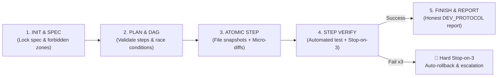

# 🚀 dev-flow — Disciplined Engineering & Development Pipeline

> **Purpose:** Canonical Primary Skill for all software development, defect remediation (bugfixing), architectural refactoring, and feature implementation across AnD os and Pulsar Space.  
> **Master CLI Engine:** `and_os/bin/dev_flow.py`  
> **Session State File:** `.dev_session.json` (deterministic finite-state machine ledger).

---

## 🎯 1. Five Fundamental Phases

Development proceeds strictly through the `dev_flow.py` CLI engine. Progressing to the next phase requires satisfying the quality gate of the preceding phase:



---

## ⚙️ 2. Step-by-Step Execution Protocol

### Step 1: Session Init & Invariant Locking
```bash
# 1.1 Start session
python3 and_os/bin/dev_flow.py init --task "Concise Task Title"

# 1.2 Lock Specification (Prohibited from writing code before locking invariants!)
python3 and_os/bin/dev_flow.py lock-spec \
  --goal "Concrete objective: what must function" \
  --forbidden "Forbidden: TCC resets; OS input hooks; system daemon restart; deleting files" \
  --acceptance "Measurable acceptance criteria (Definition of Done)"
```

### Step 2: DAG Construction & Race-Free Parallelism Analysis
Prepare temporary step definition file (`steps.json`):
```json
[
  {
    "id": "step_1",
    "title": "Isolated interface fix",
    "target_files": ["path/to/file1.py"],
    "verify_cmd": "python3 -m pytest tests/test_file1.py",
    "mode": "sequential"
  },
  {
    "id": "step_2",
    "title": "Update event loop handling",
    "target_files": ["path/to/file2.py"],
    "verify_cmd": "python3 -m pytest tests/test_file2.py",
    "depends_on": ["step_1"],
    "mode": "sequential"
  }
]
```
Load and validate DAG:
```bash
python3 and_os/bin/dev_flow.py plan --file steps.json
```
> [!IMPORTANT]
> The engine automatically audits the **file contention matrix**: if two parallel steps attempt to mutate the same target file, parallelism is blocked (`MUTUAL_EXCLUSION_REQUIRED`).

### Step 3: Atomic Step Execution
Before touching code, record step initiation. The engine automatically creates atomic file snapshots in `.dev_snapshots/`:
```bash
python3 and_os/bin/dev_flow.py step-begin --id step_1
```
Apply the **minimal surgical diff** strictly within the step scope. Incidental refactoring of unrelated methods is strictly prohibited.

### Step 4: Programmatic Verification & Circuit Breaker Guard
```bash
python3 and_os/bin/dev_flow.py step-verify
```
- If verification passes (`exit_code == 0`):
  ```bash
  python3 and_os/bin/dev_flow.py step-finish
  ```
- If verification fails:
  - Attempts 1–2: Diagnose exact stderr and fix the root cause.
  - Attempt 3: **Hard Stop-on-3 Circuit Breaker**. Engine exits with code 42, rolls back target files to their clean pre-step snapshot, and blocks further mutations.

### Step 5: Session Finalization & Honest Engineering Report
```bash
python3 and_os/bin/dev_flow.py finish --unverified "Physical touch bar verification; visual rendering smooth"
```
Compiles the final `DEV_REPORT.md` adhering to [[and_os/etc/DEV_PROTOCOL|DEV_PROTOCOL.md]].

---

## 🧩 3. Core Engine Modules (`and_os/lib/dev_flow/`)
1. `contract_guard.py` — Verifies specification invariants and prevents goal drift.
2. `dag_engine.py` — Analyzes dependency graphs, circular locks, and race-free parallelism.
3. `isolation_guard.py` — File snapshot management and rollback mechanics.
4. `verifier.py` — Test runner execution, timeouts, and Stop-on-3 counter.
5. `report_generator.py` — Generates honest markdown reports including unverified items.

## Vault Mutation Protocol (Rule #19 Invariant)
When creating, updating, or patching markdown notes inside the vault:
- DO NOT perform blind raw file overwrites via generic file tools.
- STRICTLY utilize mcp-vault-guard tools (vault_patch, vault_set_frontmatter, vault_read) or microkernel facade:
  python3 and_os/bin/sys_cli.py vault patch --file <path> --find <target> --replace <replacement>
- Ensure zero syntax corruptions in wikilinks (pipe characters) and YAML frontmatter symmetry.
