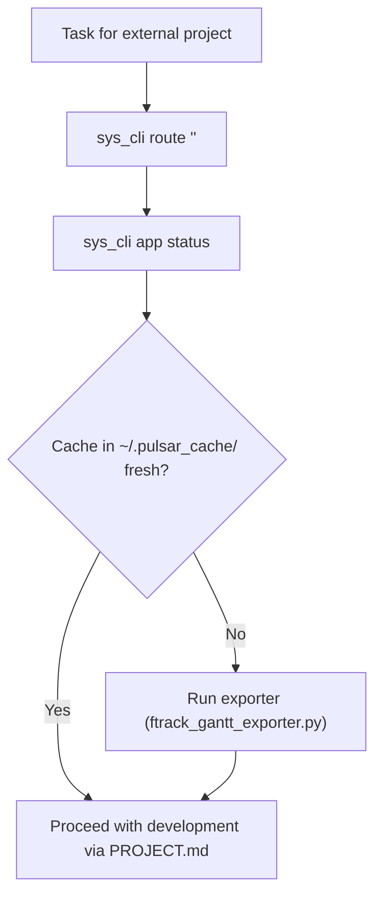

# PROJECT.md Spec — External App Onboarding Standard (Two-Contour)

> Source: consolidated from the `app-bridge` skill (archived in C10, 2026-11-15).
> All functional commands live in the `sys_cli` dispatcher — this document is the specification only.

## 1. Two-Contour Lifecycle Standard

1. **Obsidian Vault Realm:** Contains rules, contexts, knowledge bases, and SQLite indexes (`task_vault.db`). Zero binary bloat and heavy caches.
2. **External Apps & Pulsar Realm:**
   - Application source code: `and_os/opt/apps/<app_id>/` (with `PROJECT.md` at root) or `/WORK/pulsar/<service>/` (each service is a standalone git repository — recovery slice since C10);
   - Intermediate data cache: `~/.pulsar_cache/<app_id>/` (Ftrack/API dumps refreshed 1-2 times per week).

## 2. Dispatcher Commands

| Command | Description |
|---|---|
| `sys_cli app status` | Status table of external projects, active ports, and cache freshness |
| `sys_cli app blueprint --id <app_id>` | Compressed architectural prompt blueprint for cross-agent handover |
| `sys_cli project <subaction>` | Project onboarding, registration in `Nero/pulsar` passports and SQLite registry |
| `sys_cli sync` | Background syncs: domain states, task index, Obsidian blueprint, toolchain map |

## 3. PROJECT.md Specification

Every external application MUST maintain a `PROJECT.md` file in its root directory (`and_os/opt/apps/<app_id>/PROJECT.md`):

```markdown
# PROJECT: <Project Name> (v1.0.0)

> **Purpose:** [Brief summary]

## 1. Stack and Architecture
- **Frontend:** React + Vite (Port: 8050)
- **Backend:** FastAPI (Port: 8000)
- **Data Source:** ~/.pulsar_cache/<app_id>/cache.json

## 2. Execution Commands
- Dev: `npm run dev`
- Build: `npm run build`
```

## 4. Agent Execution Flow



## 5. Recovery Slice (since C10, 2026-11-15)

Each `/WORK/pulsar/<service>/` directory is a standalone git repository (branch `main`, initial commit marked `recovery slice (C10-0)`). On module damage:

1. `cd /WORK/pulsar/<service>`
2. `git log --oneline` — verify history is intact
3. `git status --porcelain` — inspect damage
4. `git checkout -- .` — restore tracked files to the last commit

Excluded from git by design: `*.dmg` installers, `research/extracted_asar/`, `.venv/`, `node_modules/`. The `/WORK/pulsar/Nero/` mirror is covered by the Obsidian Vault backup instead.

---
[[Vault|← Vault]]
