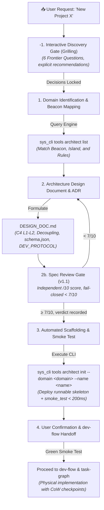

# 🏛️ System Architect Skill (AnD os System Architecture Engine)

> 💡 **TL;DR:** Master architectural bootstrap engine for AnD os. Strictly enforces **Discovery Interview Gate (Phase -1)** and **Spec-Before-Code Protocol (Phase 0)** before any application code is authored. Selects the appropriate Domain Beacon across the 9 Logical Islands, conducts the 6-question Frontier Grilling interview, generates canonical `DESIGN_DOC.md` (C4 L1-L2, ADRs, Data Contracts, DEV_PROTOCOL invariants), passes it through an **independent Spec Review Gate (fail-closed below 7/10)** (v1.1), scaffolds battle-tested runnable skeletons from `and_os/etc/blueprints/`, and conducts automated smoke verification.
> 🔗 **Cross-Links:** [[SYSTEM|SYSTEM.md]] | [[and_os/lib/skills/system-architect/references/INTERVIEW_PROTOCOL|INTERVIEW_PROTOCOL.md]] | [[and_os/lib/skills/system-architect/references/ARCHITECTURE_GENESIS_MATRIX|ARCHITECTURE_GENESIS_MATRIX.md]] | [[and_os/lib/skills/system-architect/references/SPEC_REVIEW_GATE|SPEC_REVIEW_GATE.md]] | [[and_os/lib/skills/system-architect/references/MODULE_CONTRACT|MODULE_CONTRACT.md]] | [[and_os/etc/DEV_PROTOCOL|DEV_PROTOCOL.md]] | [[and_os/lib/skills/task-graph/SKILL|task-graph]] | [[and_os/lib/skills/dev-flow/SKILL|dev-flow]]

---

## 🎯 Purpose & Trigger

Activated whenever the user requests the start, design, or bootstrap of a new software system or pipeline:
1. **Pulsar Local Dashboard (:8080–:8099):** Offline-first cached analytics (*e.g., "Make a local site for project X"*).
2. **Deployable Public Web / Cloud:** Client/Server architecture, Dockerfile, zero hardcoded secrets (*e.g., "Design a server-hosted web portal for Ta-Bu"*).
3. **Xcode Native Game / App:** Swift 6, SpriteKit, EscPlanet engine (*e.g., "Let's start game development"*).
4. **Hybrid 3D + Generative AI Pipeline:** Blender greybox, ComfyUI, Parallax Guard, DaVinci (*e.g., "Design a 3D+AI pipeline for a shot"*).
5. **Interactive Tool / Canvas:** Single-file web SPA tool (*e.g., "Make an interactive canvas"*).
6. **Core Service / CLI / Daemon:** AnD os microkernel extension (*e.g., "Create a new system utility in and_os"*).

---

## 🚫 Hard Prohibitions (Anti-Patterns)

- **Skipping Discovery Interview:** Proceeding to design or implementation without passing the Phase -1 Discovery Gate (6 Frontier Questions) is **CATEGORICALLY PROHIBITED**.
- **Writing Application Code Before Architecture:** Writing business logic or UI code before generating and verifying `DESIGN_DOC.md` is **CATEGORICALLY PROHIBITED**.
- **Violating Domain Beacons:** Placing executable code inside the Obsidian Vault (violates Rule #27 Muscle Realm Isolation).
- **Direct Vault Edits:** Editing user knowledge notes without MCP `mcp-vault-guard` (`vault_patch`) (violates Rule #19 Dual-Speed Governance).
- **Ad-hoc Custom Protocols:** Bypassing platform SDKs or hardcoding external API calls into offline frontend dashboards (violates Rule #59 and Rule #64).
- **Leaky Abstractions:** Directly coupling UI/Presentation views with raw SQL or remote network gateways (violates Clean Architecture Dependency Invariant).

---

## 🛠️ Execution Protocol (5-Phase Architecture Pipeline)

---

## 📋 Verification Checklist (Genesis Quality Gate)

- [ ] **Discovery Interview Gate passed:** exactly 6 Frontier Questions answered with locked decision block; recommendations presented first.
- [ ] No parallel spec: existing `DESIGN_DOC.md`/`AGENTS.md` of the same project checked first (update, don't duplicate).
- [ ] Project directory mapped to the designated Domain Beacon.
- [ ] Port verified and collision-free within `:8080–:8099` (if web).
- [ ] `docs/DESIGN_DOC.md` authored with explicit MADR, Data Contract, and Rule numbers.
- [ ] **Spec Review Gate passed:** independent reviewer score ≥ 7/10 with per-criterion evidence; verdict appended to `DESIGN_DOC.md` (below 7/10 — scaffolding is prohibited).
- [ ] **Module contracts for non-trivial modules** (MODULE_CONTRACT.md): non-goals, invariants, acceptance examples with failure cases, change-impact section.
- [ ] LLM-Native Anchor `AGENTS.md` deployed in project root (< 300 tokens, strict command harness).
- [ ] 12-Factor config deployed (`.env.example` + fail-fast startup validator).
- [ ] Clean Architecture layer boundaries respected (Pure Domain separated from I/O Adapters).
- [ ] Runnable skeleton deployed from `and_os/etc/blueprints/`.
- [ ] Automated smoke test executed and passes with green exit code 0 (< 200ms).
- [ ] Pre-flight `sys_cli verify` executed cleanly.
