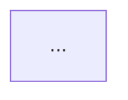

## Catalogs & Scope
- [[Tasks/CONTEXT|Tasks — backlog and active sprints]]
- [[and_os/lib/skills/ROUTING|ROUTING — skills and domain routing matrix]]
- [[and_os/bin/graph_builder.py|graph_builder.py — DAG graph compilation engine]]

## Scope
Universal planning and execution orchestrator for **complex, multi-step, or cross-domain tasks** (modes `WORK`, `STRATEGIC`, `SYSTEM`). Implements **Rule №20 (Task Execution Graph / DAG Orchestration)**.

Strictly prohibits blind sequential execution of non-trivial tasks. Deconstructs objectives into a **Directed Acyclic Graph (DAG)** where each node declares designated skills, deterministic helper scripts ("Think in Code", Rule №16), IO artifacts, parallelism swimlanes, and Definition of Done (DoD) verification gates.

---

## Node Contract Specification

Every node in the DAG must declare 8 attributes:
1. **Node ID & Title:** Unique identifier (`step_1`, `step_2a`, etc.) and concise action description.
2. **Phase / Subgraph:** Logical milestone container (e.g., `Phase 1: Ingestion`, `Phase 2: Analytics`, `Phase 3: Assembly`).
3. **Primary Skill (🎯):** Assigned primary skill from the 50-skill registry (e.g., `ftrack-sync`, `story-dev`, `document-hub`).
4. **Script (⚙️):** Deterministic tool from `and_os/bin/` adhering to Rule №16. Specify `—` if strictly analytical.
5. **Input & Output (📥 📤):** Precise filesystem paths, tables, or APIs for data consumption and persistence.
6. **Execution Mode:** `Sequential` vs `Parallel` (independent swimlane branch).
7. **Definition of Done (DoD ✅):** Unambiguous empirical validation gate; blocks downstream execution if unmet.
8. **Source Evidence / SRC Grounding (🔍):** File and line citation grounding the node's existence (`file:///path/to/file.py#L40-L80` or `Nero/profile/health.md`). Prevents hallucinated nodes per Archify standard.

---

## 4 Graph Topology Patterns (Anthropic Pattern Standard)

| Pattern | Description | Application Context |
|---|---|---|
| **Chain** | Linear sequence: Step A → Step B → Step C | Hard dependencies with zero potential concurrency |
| **Parallel (Fork/Join)** | Branching: Fork → concurrent workers → Join Gate | Independent subtasks executable simultaneously |
| **Routing** | Conditional branch: IF (condition) THEN (Path X) ELSE (Path Y) | Dynamic domain/skill dispatch based on input properties |
| **Loop (Evaluator-Optimizer)** | Iterative refinement loop: Step → Evaluate → Improve | Optimization, test-driven self-correction. **Requires Circuit Breaker** |

---

## Circuit Breaker — Rule №20 (Infinite Loop Preventer)

**For any node declaring `mode: "loop"` or `pattern: "evaluator-optimizer"`:**
- Must declare `max_iterations: N` where N ≤ 3.
- When iteration limit is reached, **halt loop immediately and escalate to user**. Never loop unboundedly.

**Rationale:** Without hard termination gates, self-reflective loops succumb to autoregressive drift and quality degradation.

```json
{
  "id": "step_refine",
  "title": "Iterative Refinement",
  "mode": "loop",
  "pattern": "evaluator-optimizer",
  "max_iterations": 3,
  "depends_on": ["step_draft"]
}
```

Validation: `python3 and_os/bin/graph_builder.py --file task.json --circuit-breaker`

---

## Critical Path Method (CPM) — Rule №20

**Critical Path:** The sequence of dependent nodes yielding the maximum cumulative weight (`duration`). It dictates the absolute minimum execution time of the entire task.

**Core Invariant:** Optimize and unblock the critical path first, rather than expending resources on non-blocking peripheral steps.

Visualization & CLI evaluation:
```bash
# Mermaid rendering with highlighted critical edges:
python3 "and_os/bin/graph_builder.py" --test --mermaid --critical-path

# Obsidian Canvas export with highlighted cards and edges:
python3 "and_os/bin/graph_builder.py" --test --canvas "output.canvas" --critical-path
```

---

## Orchestrator Execution Pipeline

1. **Decomposition:**
   Deconstruct prompt into atomic subtasks. Isolate hard dependencies from concurrent tracks.
2. **Tool & Skill Binding:**
   Bind each node to exactly one primary skill (`ROUTING.md`) and deterministic script (`and_os/bin/`).
3. **Concurrency Topography (Fork / Join):**
   Group independent tasks into concurrent swimlanes (Fork). Converge into Join Gate before downstream progression.
4. **Graph Artifact Generation (Think in Code):**
   - For markdown logs/chat: render Mermaid DAG.
   - For complex multi-day projects: compile `.canvas` workspace:
     ```bash
     python3 "and_os/bin/graph_builder.py" --file task_dag.json --mermaid --critical-path
     python3 "and_os/bin/graph_builder.py" --file task_dag.json --canvas "Tasks/Plans/task.canvas" --critical-path
     ```
5. **Execution & Gate Validation:**
   Execute sequentially or concurrently, validating every node against its explicit Definition of Done (DoD).

---

## Archetype DAG Templates

### 1. Feature Animation Production Pipeline
- **Phase 1 (Ingestion):** `ftrack-sync` (`ftrack_sync.py`) + `weeek-hub` (`weeek_sync.py`) → milestone quota snapshots.
- **Phase 2 (Parallel Swimlanes):**
  - Branch A: `ftrack-sync` (`ftrack_report.py`) → departmental timesheets and blocker analysis.
  - Branch B: `employee-hub` (`doc_analyze.py`) → artist bandwidth and compensation parity.
  - Branch C: `weeek-hub` → sprint board grooming and task re-prioritization.
- **Phase 3 (Join Gate):** `status-report` → executive synthesis and stakeholder escalation.

### 2. Narrative & Dramaturgy Pipeline
- **Phase 1 (Research):** `clipping-finder` / `book-hub` → reference extraction and factual grounding.
- **Phase 2 (Parallel Swimlanes):**
  - Branch A: `story-dev` → logline, synopsis, 3D character web, step outline.
  - Branch B: `ta-bu-plan` + `budget-calculator` → production budget, runtime, shot count estimates.
  - Branch C: `ai-rule` (Workflow 2) → visual concept art and storyboard prompts.
- **Phase 3 (Join Gate):** `investor-outreach` or `cg-article` → pitch deck assembly or industry essay.

### 3. System Integrity & Core Audit Pipeline
- **Phase 1 (Diagnostic Root):** `system-audit` (`sys_cli.py audit --deep`) → 6-Ring health verification.
- **Phase 2 (Parallel Swimlanes):**
  - Branch A: `sync-context` (`sync_context.py --check`) → audit 48 `CONTEXT.md` navigation files.
  - Branch B: `system-audit` → compile 7-vector telemetry metrics from `telemetry.md`.
- **Phase 3 (Join Gate):** `system-audit` → emit signed system audit report to `and_os/var/`.

---

## Output Format

User reports delivered in Russian:

```markdown
# [Task Name] — Directed Acyclic Graph (DAG) Execution Flow
<!-- User report localized in Russian for Andrey -->

## 📊 Visual Process Graph


## ⚡ Critical Path
[Node IDs formatted as A → B → C, total estimated duration]

## 📋 Stage Specification & Definition of Done (DoD)
| Stage | Mode | Skill | Script | Input → Output | Definition of Done (DoD) |
|---|---|---|---|---|---|
| 1. ... | Seq | `skill-name` | `script.py` | input → output | DoD description |
| 2A. ... | Parallel | `skill-name` | `script.py` | input → output | DoD description |
| 2B. ... | Parallel | `skill-name` | — | input → output | DoD description |
| 3. ... | Join | `skill-name` | — | inputs → final | Final deliverable DoD |

*(Interactive Canvas board generated: `path_to_board.canvas`)*
```

## Verification Checklist
- [ ] Graph is strictly acyclic (DAG, zero infinite cycles)
- [ ] Every node binds an explicit primary skill and script (where applicable)
- [ ] Concurrency swimlanes explicitly declared (`Parallel`)
- [ ] Every node specifies an empirical Definition of Done (DoD)
- [ ] Loop nodes enforce `max_iterations <= 3` (Circuit Breaker)
- [ ] Critical path calculated and prioritized for optimization
- [ ] Graph compiled via Mermaid and/or `.canvas`

## Anti-Triggers & Constraints
- Never execute complex multi-step tasks blindly without generating an execution DAG
- Never assign non-existent tools, scripts, or skills
- Never force sequential execution when subtasks are independent
- Never permit loop nodes lacking an explicit `max_iterations` bound (Circuit Breaker violation)
- Do not waste optimization effort on peripheral low-latency tasks instead of the critical path

## Vault Mutation Protocol (Rule #19 Invariant)
When creating, updating, or patching markdown notes inside the vault:
- DO NOT perform blind raw file overwrites via generic file tools.
- STRICTLY utilize mcp-vault-guard tools (vault_patch, vault_set_frontmatter, vault_read) or microkernel facade:
  python3 and_os/bin/sys_cli.py vault patch --file <path> --find <target> --replace <replacement>
- Ensure zero syntax corruptions in wikilinks (pipe characters) and YAML frontmatter symmetry.
