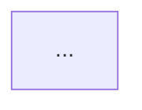

# DAG Templates & Output Contract for `task-graph`

> Detail reference (on demand). SKILL.md holds the node contract and graph rules; this file holds the three Andrey-specific archetype pipelines and the full Russian output template.

## 1. Archetype DAG Templates

### A. Feature Animation Production Pipeline
- **Phase 1 (Ingestion):** `ftrack-sync` (`ftrack_sync.py`) + `weeek-hub` (`weeek_sync.py`) → milestone quota snapshots.
- **Phase 2 (Parallel swimlanes):**
  - Branch A: `ftrack-sync` (`ftrack_report.py`) → departmental timesheets and blocker analysis.
  - Branch B: `employee-hub` (`doc_analyze.py`) → artist bandwidth and compensation parity.
  - Branch C: `weeek-hub` → sprint board grooming and task re-prioritization.
- **Phase 3 (Join Gate):** `status-report` → executive synthesis and stakeholder escalation.

### B. Narrative & Dramaturgy Pipeline
- **Phase 1 (Research):** `clipping-finder` / `book-pipeline` → reference extraction and factual grounding.
- **Phase 2 (Parallel swimlanes):**
  - Branch A: `story-dev` → logline, synopsis, 3D character web, step outline.
  - Branch B: `ta-bu-plan` + `budget-calculator` → production budget, runtime, shot count estimates.
  - Branch C: `ai-rule` (Workflow 2) → visual concept art and storyboard prompts.
- **Phase 3 (Join Gate):** `investor-outreach` or `cg-article` → pitch deck assembly or industry essay.

### C. System Integrity & Core Audit Pipeline
- **Phase 1 (Diagnostic root):** `system-audit` (`sys_cli.py audit --deep`) → 6-Ring health verification.
- **Phase 2 (Parallel swimlanes):**
  - Branch A: `sync-context` (`sync_context.py --check`) → audit the 48 `CONTEXT.md` navigation files.
  - Branch B: `system-audit` → compile the 7-vector telemetry metrics from `telemetry.md`.
- **Phase 3 (Join Gate):** `system-audit` → emit signed system audit report to `and_os/var/`.

## 2. Output Format (RU for Andrey)

```markdown
# [Task Name] — Directed Acyclic Graph (DAG) Execution Flow
<!-- User report localized in Russian for Andrey -->

## 📊 Visual Process Graph


## ⚡ Critical Path
[Node IDs as A → B → C, total estimated duration]

## 📋 Stage Specification & Definition of Done (DoD)
| Stage | Mode | Skill | Script | Input → Output | DoD |
|---|---|---|---|---|---|
| 1. ... | Seq | `skill-name` | `script.py` | input → output | DoD description |
| 2A. ... | Parallel | `skill-name` | `script.py` | input → output | DoD description |
| 2B. ... | Parallel | `skill-name` | — | input → output | DoD description |
| 3. ... | Join | `skill-name` | — | inputs → final | Final deliverable DoD |

*(Interactive Canvas board generated: `path_to_board.canvas`)*
```

---
[[Vault|← Vault]]
